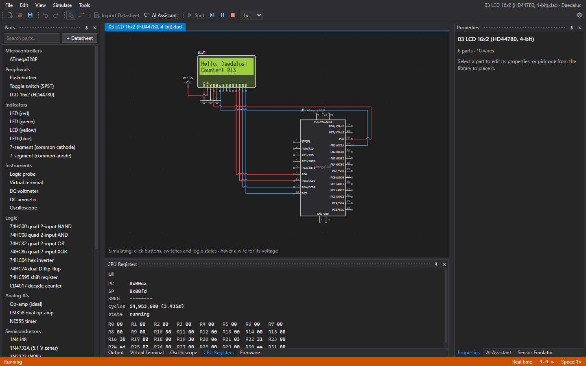
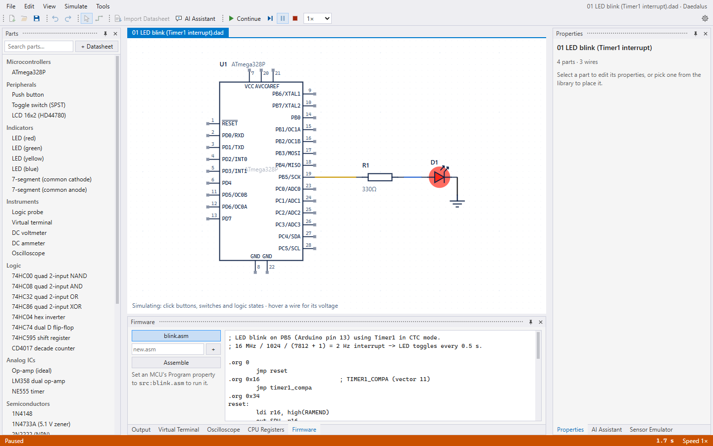
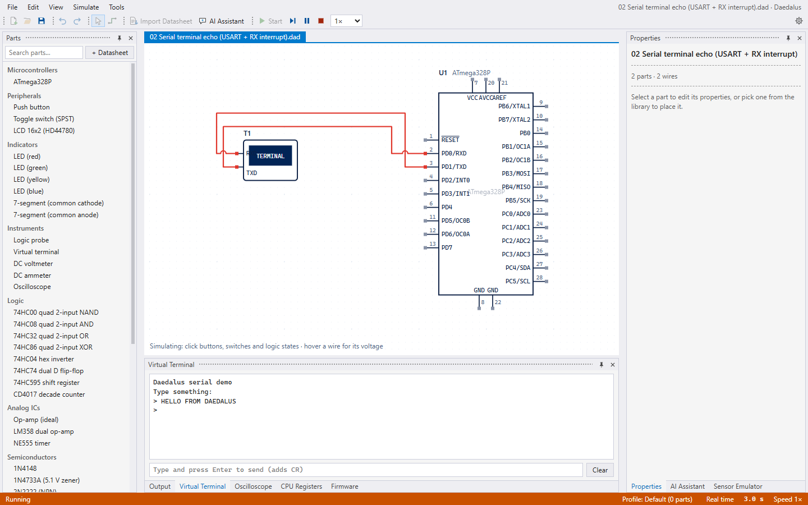
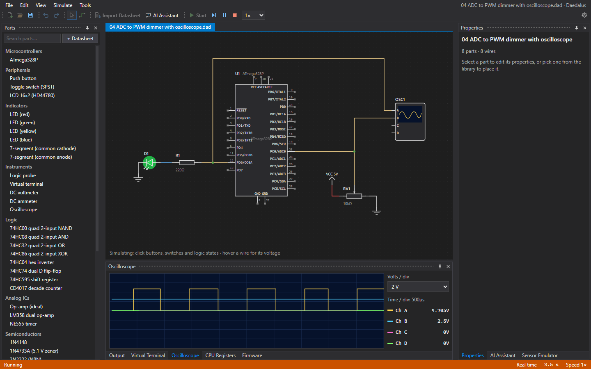
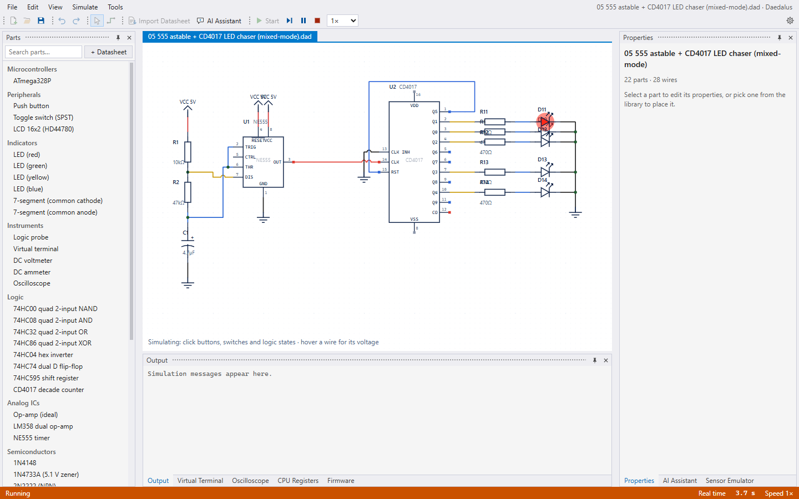
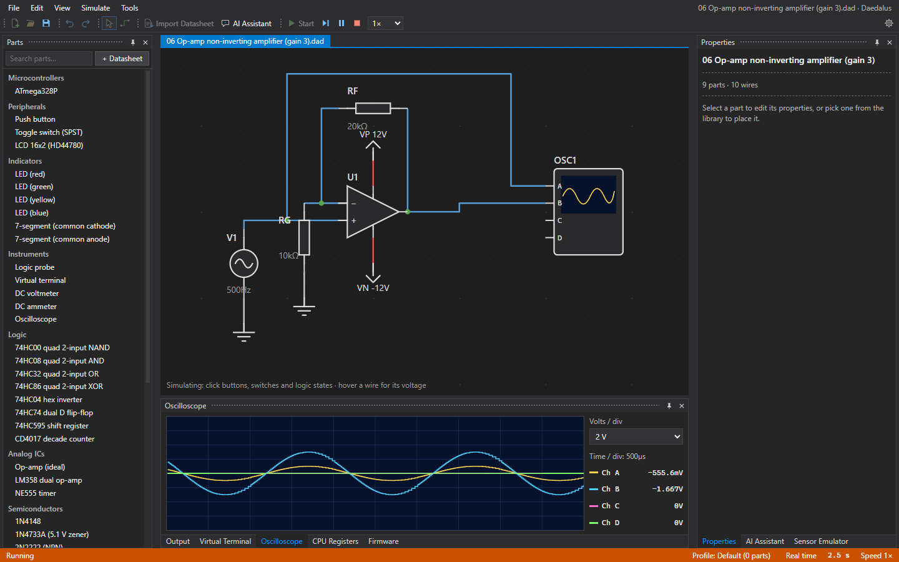
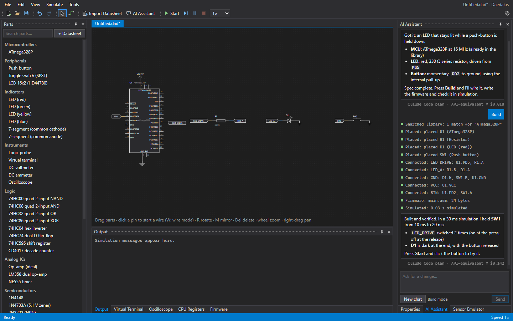
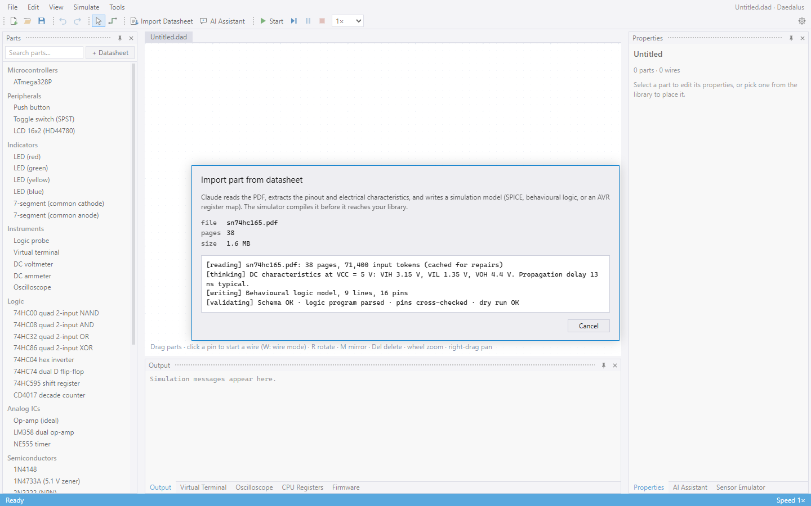
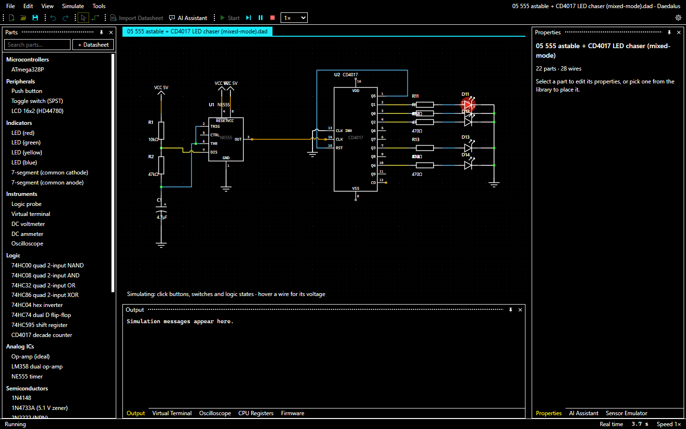
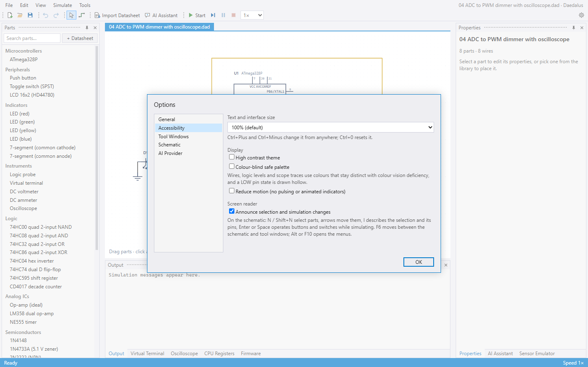

<!-- Generated by `npm run readme` from scripts/readme/template.md. Edit the template, not this file. -->


# Daedalus

A desktop circuit simulator: schematic capture, mixed-mode SPICE plus event-driven digital simulation, instruction-level microcontroller co-simulation, interactive peripherals, and **AI datasheet import**. You give it a component's PDF datasheet and Claude turns it into a part you can simulate.



Electron + React + TypeScript, version 0.1.0. The simulation engine (`src/sim`) is plain TypeScript with no DOM or Node dependencies. It runs in a Web Worker in the app and directly under the test runner.

## Highlights

- **Firmware runs on the schematic.** An AVR8 instruction-set simulator executes your HEX or assembly against the circuit in real time, with GPIO, timers, PWM, USART, ADC, interrupts and EEPROM.
- **Analogue and digital in one run.** A SPICE-style MNA solver and an event-driven logic simulator share nets, so a 555 can clock a CMOS counter that drives LEDs through resistors.
- **Interactive parts and instruments.** LEDs, 7-segment displays and a 16x2 LCD animate; buttons, switches and pots respond to clicks; a virtual terminal, oscilloscope, logic probe and meters read the circuit.
- **AI design assistant.** Describe a project in plain English. Claude picks parts, imports their datasheets, wires the schematic, writes firmware and simulates it to check the result.
- **AI datasheet import.** Hand Claude a PDF and get a validated simulation model: SPICE, behavioural logic, or an AVR register map.
- **Accessible.** High contrast theme, colour-blind safe palette, 100 to 200% scaling, full keyboard control and screen reader support.

## Tour

### Microcontroller co-simulation

The ATmega328P runs real machine code. Write assembly in the **Firmware** tab (assembled by the built-in two-pass AVR assembler) or point the part at an Intel HEX file from avr-gcc or the Arduino IDE. Watch the CPU registers in the **CPU Registers** tab.



The **Virtual Terminal** is a pin-level UART: it decodes the bits the USART puts on the TX pin and drives keystrokes back onto RX.



### Mixed-mode analogue and digital

Digital outputs on analogue nets become Norton sources, and digital inputs read node voltages through VIL/VIH thresholds with hysteresis. Here a potentiometer feeds the ADC, firmware sets the Timer0 PWM duty cycle, and the oscilloscope shows the waveform reaching the LED.



No microcontroller needed: an NE555 astable (analogue, solved by the MNA engine) clocks a CD4017 decade counter (behavioural logic) that walks a row of LEDs.



Pure analogue circuits work too, with sources, op-amps, transistors and diodes.



### AI design assistant

Describe what you want in the **AI Assistant** window. It interviews you until the design is specified, then builds it: places and wires parts, writes firmware, and runs the simulation to verify the behaviour you asked for. The schematic updates live as it works.



### Datasheet import

Pick a PDF, check the estimated cost, and Claude reads the pinout, function tables and electrical characteristics. The simulator compiles what comes back (schema, SPICE, logic program, pin cross-references, dry run) before it reaches your library, and sends errors back to Claude for repair.



### Accessibility

High contrast and colour-blind safe palettes, interface scaling, reduced motion and screen reader announcements, all under **Tools → Options → Accessibility**.





## Getting started

```
npm install
npm run dev          # Electron app with hot reload
npm test             # 106 tests: solver, digital, AVR core, examples end-to-end
npm run build        # production bundle in out/
npm run readme       # retake the screenshots and regenerate this README
npx vite --config vite.renderer.config.ts   # renderer only, in a browser (no file dialogs / import)
```

Open **File → Examples…** to load one of the bundled circuits, then press **Start** (F12).

### Parts and inventory service

The app talks to the [daedalus-api](../daedalus-api) Worker at `https://daedalus-api.cd-cloud.workers.dev`. Set `DAEDALUS_API_URL` in `.env` (gitignored) to use another one (`http://localhost:8787` for `npm run dev` there), or set it empty to keep everything on this machine. The app keeps this install's imported parts and its profiles' inventory there; built-in parts always ship with the app. On first connection the app registers as an anonymous device: the API issues a random token, stored encrypted in `settings.json`, and keeps only its hash. Nothing about the machine or user is sent. Existing local profiles are uploaded once (the folder is then renamed `profiles-uploaded-*`). **Parts Inventory → Pair Phone…** shows a QR code for the [inventory scanner](../daedalus-inventory-scanner) Android app, which adds parts by reading part numbers off chips and bag labels with the phone's camera. Paired phones are listed there and can be unpaired. Saving the inventory keeps anything a phone added while the dialog was open. Datasheet PDFs stay on disk. If the API can't be reached, part saves are kept in the local library folder and uploaded on the next listing that connects, and the last listing and profiles read are cached so the library and inventory still load offline. Packaged builds read `.env` from the user data folder.

## Examples

All verified end to end by `test/examples.test.ts`.

| # | Circuit | Parts | File |
|---|---|---|---|
| 01 | LED blink (Timer1 interrupt) | 4 | [`01-blink.dad`](examples/01-blink.dad) |
| 02 | Serial terminal echo (USART + RX interrupt) | 2 | [`02-serial-echo.dad`](examples/02-serial-echo.dad) |
| 03 | LCD 16x2 (HD44780, 4-bit) | 6 | [`03-lcd-16x2.dad`](examples/03-lcd-16x2.dad) |
| 04 | ADC to PWM dimmer with oscilloscope | 8 | [`04-adc-pwm-dimmer.dad`](examples/04-adc-pwm-dimmer.dad) |
| 05 | 555 astable + CD4017 LED chaser (mixed-mode) | 22 | [`05-555-4017-chaser.dad`](examples/05-555-4017-chaser.dad) |
| 06 | Op-amp non-inverting amplifier (gain 3) | 9 | [`06-opamp-amplifier.dad`](examples/06-opamp-amplifier.dad) |
| 07 | Button + LED (built by assistant tools) | 14 | [`07-assistant-built-button-led.dad`](examples/07-assistant-built-button-led.dad) |

## Built-in parts

| Category | Parts |
|---|---|
| Microcontrollers | `ATMEGA328P` |
| Logic | `74HC00` `74HC08` `74HC32` `74HC86` `74HC04` `74HC74` `74HC595` `CD4017` |
| Analogue ICs | `OPAMP` `LM358` `NE555` |
| Discretes | `1N4148` `1N4733A` `2N2222` `2N3906` `2N7000` |
| Passives | `RES` `CAP` `CAP-ELEC` `IND` `POT` |
| Sources | `BATTERY` `VSINE` `VPULSE` `DCLOCK` `LOGICSTATE` |
| Indicators | `LED-RED` `LED-GREEN` `LED-YELLOW` `LED-BLUE` `7SEG-CC` `7SEG-CA` |
| Inputs and displays | `BUTTON` `SWITCH` `LCD1602` |
| Instruments | `LOGICPROBE` `VTERM` `VOLTMETER` `AMMETER` `SCOPE` |
| Terminals | `GROUND` `POWER` `NETLABEL` |

Anything else comes in through datasheet import or the AI assistant.

---

## How the simulator works

| Piece | Implementation | Where |
|---|---|---|
| Analogue kernel | MNA + Newton-Raphson, backward-Euler transient, SPICE `pnjlim` limiting, adaptive timestep | `src/sim/analog/mna.ts`, `elements.ts` |
| SPICE primitives | SPICE netlist subset: R C L V I D Q M E G S + behavioural `OPAMP`, `.model` cards | `src/sim/analog/spice.ts` |
| Event-driven digital simulator | Timed event queue, strength-resolved nets (strong/weak/Z, conflicts give X) | `src/sim/events.ts`, `logic.ts`, `engine.ts` |
| Digital/analogue interface | Digital outputs on analogue nets become Norton sources (VOH/VOL behind Rout). Digital inputs read node voltages through VIL/VIH thresholds with hysteresis | `engine.ts` (`attachMixedPins`, `sampleThresholds`) |
| Model interface | `SimModel`: `setup`, `advance`, `afterAnalogStep`, `indicate`, `actuate` | `src/sim/engine.ts` |
| Model kinds | `model.kind`: `spice` / `logic` / `mixed` / `builtin` / `mcu` | `src/shared/component.ts` |
| CPU models | AVR8 instruction-set simulator with GPIO, timers 0/1/2 (normal/CTC/fast PWM/phase-correct), USART, ADC, INT0/1, PCINT, EEPROM | `src/sim/mcu/avr/` |
| Animated parts (LED, LCD, switches) | Built-in interactive models plus SVG indicators | `src/sim/models/builtins.ts`, `src/renderer/src/PartView.tsx` |
| Virtual instruments | Virtual terminal (pin-level UART), oscilloscope, logic probe, volt/ammeter | same |
| Real-time simulation | Worker paces simulated time against wall clock and shows % real time when it can't keep up | `src/renderer/src/sim.worker.ts` |

The CPU co-simulation loop works like this. Each slice, CPU models run ahead to the slice end and emit timestamped pin events. The digital queue drains. Then the analogue matrix is solved, threshold crossings feed back into the digital side, and the slice length adapts: it drops to 1 µs on any edge into an analogue net and grows while voltages are quiet.

---

## Datasheet import (Claude)

**Parts → + Datasheet** or **Import datasheet…**

1. Pick a PDF. Optionally name the part ("74HC165 in DIP-16") and choose a page range. Claude reads at most 600 pages per request, so large MCU datasheets need a range covering the pinout, register summary and DC characteristics.
2. **Estimate cost** counts the tokens first. Datasheets are large; a 40-page logic datasheet is roughly 60k to 100k input tokens.
3. **Import with Claude** sends the PDF to `claude-opus-5-5` with adaptive thinking. The output is constrained to the component JSON schema (structured outputs), and the reasoning summary streams into the dialog as progress.
4. The simulator **compiles the result**: schema check, SPICE parse, logic-program parse, pin cross-references, AVR register-map sanity, and a dry-run instantiation. Errors go back to Claude for up to two repair turns. The PDF is prompt-cached, so repairs re-read it at about 5% of the cost.
5. Review the pins, model code and notes, edit the JSON if you want, then **Save & place**. Imported parts are stored in the app's user-data folder and also embedded in any project that uses them.

Claude picks the model type to fit the part:

- **Discrete and analogue parts** become a SPICE netlist with `.model` parameters, fitted from the datasheet curves if no SPICE model is printed.
- **Logic ICs and serial peripherals** become a program in the behavioural DSL below.
- **Mixed parts** (555, comparators, ADC chips) get both.
- **AVR microcontrollers** become an `avr8` variant built from the Register Summary and Interrupt Vectors tables. Firmware then runs on the imported chip.
- **Other MCUs** (ARM, PIC, ESP32...) are imported pin-accurate with port mappings, marked `unsupported` until there's a core for them.
- **Displays, buttons and LEDs** map onto the built-in interactive models.

Credentials: set `ANTHROPIC_API_KEY`, or save a key under **Settings** (it's encrypted with the OS key store via Electron `safeStorage`). The API is only called from the main process, so the key never reaches the page. The import is in `src/main/datasheet.ts` and the prompt is in `src/main/import-prompt.ts`.

### Behavioural logic DSL (what Claude writes for digital parts)

```
state sr = 0
state latch = 0
on rising(SHCP) { sr = MR ? ((sr << 1) | DS) & 0xFF : 0 }
on rising(STCP) { latch = sr }
always {
  if (!MR) sr = 0
  bus(Q0..Q7) = OE ? Z : latch     // Z = high impedance
  Q7S = bit(sr, 7)
}
```

It's interpreted, never `eval`'d, so model text from an AI or a file can't run code. The language has edge handlers (`rising`/`falling`/`change`), `always` blocks for combinational logic, `bus()` for reading and writing pin ranges, `v(PIN)` for analogue reads in mixed models, and open-drain/tri-state outputs. Unconnected active-low inputs (`~NAME`) read as inactive. Built-in 74HC00/04/08/32/74/86/595, CD4017 and NE555 are written in this same DSL, so built-in and imported parts take the same code path.

## AI provider: Claude Code or the Claude API

Datasheet import and the design assistant can run on either of two back ends. You choose in **Settings → AI provider**:

- **Claude Code.** This uses your locally installed `claude` CLI and its login, so it runs on your Claude Code plan and you don't need an API key. Each import or assistant turn runs `claude -p` headless.
  - **Datasheet import:** only the `Read` tool is enabled; it reads PDFs page by page. The component comes back through `--json-schema` structured output, and repair rounds continue the same session with `--resume`.
  - **Assistant:** the schematic tools are served to Claude Code over a localhost MCP server, bound to `127.0.0.1` on a random port with a bearer token for each run. Only those tools plus `WebSearch`/`WebFetch` are enabled, in `dontAsk` permission mode.
  - **Isolation:** your hooks, `CLAUDE.md` files, settings and MCP servers are **not** loaded for these runs (`--setting-sources "" --strict-mcp-config`).
  - **Code:** `src/main/claude-code.ts`, `datasheet-claude-code.ts`, `mcp-server.ts`.
- **Claude API.** This uses the Anthropic SDK with an API key from Settings or `ANTHROPIC_API_KEY`, as described below.

**Automatic** (the default) picks Claude Code when the CLI is installed and no API key is set.

Live tests against your real Claude Code run with `LIVE_CLAUDE_CODE=1 npx vitest run test/live-claude-code.test.ts` and use your plan. One imports a synthetic datasheet. The other has the assistant build a blinking-LED circuit, write and fix its firmware, and confirm 2 Hz in simulation. Both pass.

## AI design assistant

Click **AI Assistant** in the toolbar. You describe what you want to build in the chat ("a reaction-time game with a button and an LCD"), and the assistant works through it in stages:

1. **Concept → parts.** It asks only the questions that change the design. Then it proposes real part numbers, using `web_search` and `web_fetch` plus the library, and waits for you to confirm.
2. **Import.** For each confirmed part that isn't in the library, it finds the manufacturer's datasheet PDF and calls `import_datasheet_from_url`.
   - The app downloads the PDF, counting tokens first. It only accepts public http(s) addresses, files that really are PDFs, and files of 30 MB or less.
   - An approval card shows the estimated cost, and nothing is imported until you click **Import**.
   - If no PDF link turns up, it asks you to pick a local file instead.
   - Either way, it runs the same import pipeline as the datasheet dialog.
3. **Wiring.** It places parts and auto-arranges them without overlap. It joins pins into named nets with `connect`.
   - Each pin gets a short stub ending in a net label. Labels with the same name are connected, the way people wire busy schematic sheets, so there's no wire routing for the model to get wrong.
   - `GND` becomes ground symbols, and supply nets become power rails.
4. **Firmware.** For AVR parts it writes assembly with `write_firmware`. Assembler errors come back with the line number and source text.
5. **Verification.** `run_simulation` runs the circuit headless in a worker. It can script button presses, pot moves and terminal input. It reports LEDs, LCD text, terminal output, 7-segment digits, scope min/max/frequency, watched nets and warnings, and the assistant fixes the design until the result matches what you asked for.

You see the schematic update live as it builds. The conversation keeps going, so you can ask for changes ("use a green LED", "add a reset button").

How it's built:
- The agent loop runs in the main process (`src/main/assistant.ts`, the SDK tool runner, `claude-opus-5-5`).
- Schematic tools run in the renderer against the live project (`src/renderer/src/assistant/executor.ts`) over IPC.
- Editing operations are in `src/shared/edit.ts`, and the headless report is `src/sim/headless.ts`.
- `test/assistant.test.ts` drives the tools exactly as Claude would. It builds a button-controlled LED from nothing, programs it, simulates it, and rebuilds the LCD example from tool calls alone. `examples/07-*.dad` was generated that way.

## Firmware

An MCU's **Program file** property takes one of:
- an Intel HEX path (Arduino IDE *Export compiled binary*, avr-gcc, Microchip Studio),
- an `.asm` path, assembled on run,
- `src:name.asm`, a source stored in the project. Edit it in the **Firmware** tab; it's assembled with the built-in two-pass AVR assembler.

Watch the CPU registers in the **CPU** tab and serial output in **Terminal**.

## Accessibility

**Tools → Options → Accessibility** (saved per machine):
- **Text and interface size**, 100 to 200%. Ctrl+Plus, Ctrl+Minus and Ctrl+0 work from anywhere.
- **High contrast theme**: black, white, cyan and yellow. The *Use system setting* theme switches to it when Windows high contrast mode is on.
- **Colour-blind safe palette** (Okabe-Ito) for wires, logic levels and scope traces. A LOW pin state is drawn hollow, so the state isn't shown by colour alone.
- **Reduce motion** turns off pulsing indicators. The OS "reduce animations" setting is also respected.
- **Screen reader announcements** for selection, part moves and simulation state.

Keyboard:

| Where | Keys |
|---|---|
| Anywhere | Alt or F10 opens the menu bar; Alt+F/E/V/S/T opens that menu. F6 / Shift+F6 move between the schematic and tool windows. |
| Schematic | N / Shift+N select the next or previous part. Arrows move it (Shift: 5 grid steps), or pan with nothing selected. R rotate, M mirror, Del delete, I describe the selection and its pins and nets (with live levels while simulating), + / − zoom. While simulating, Enter or Space operates the selected button, switch or logic state. |
| Parts list | Arrows, Home/End, PageUp/PageDown. Enter picks the part and moves focus to the schematic, where arrows position it and Enter places it (Shift+Enter places several). |
| Tool windows | Arrow keys switch tabs in a group. Splitters take focus with Tab and move with the arrow keys. |

Menus, dialogs, tabs, the parts list and the toolbar follow the WAI-ARIA patterns. Dialogs keep focus inside them and give it back when they close. axe-core reports no violations in the Light, Dark and High Contrast themes, with or without a dialog open.

Not covered yet: drawing wires from the keyboard (ask the AI Assistant to connect pins instead; the Properties window lists each pin's connections), and docking or floating tool windows without a mouse (use **View** to show or hide them, or **Reset Window Layout**).

## Known gaps

- Only the AVR8 core executes firmware. ARM Cortex-M, PIC and 8051 parts import as wiring-only.
- AVR SPI and TWI (I²C) hardware, watchdog reset, and sleep-mode power details aren't modelled. USART frames are 8N1 only.
- No `.subckt` support: vendor macro-models have to be flattened to primitives or approximated with `OPAMP`.
- No source-level debugging, breakpoints or ELF/COF symbols yet. The CPU tab shows live registers.
- Dragging a part doesn't stretch its wires.
- The datasheet import hasn't been run against the live Claude API on this machine (no key was configured); it has been run live through Claude Code. Its request, schema and validation are covered offline by `test/schema.test.ts` and `test/library.test.ts`.
- The design assistant has run live through Claude Code (see above) but not against the Claude API directly, since no key was configured. The API path's SDK request shape passes the type checker but hasn't been tried live.

## About this README

`README.md` is generated. The text lives in `scripts/readme/template.md`; `npm run readme` starts the renderer, drives the real UI through each scene in `scripts/readme/capture.cjs`, saves the screenshots to `docs/images/`, and fills in the test count, examples and parts list from the repo. The AI screenshots replay a scripted conversation (`scripts/readme/demo-api.cjs`) through the app's real tool executor, so they don't call Claude or cost anything.
